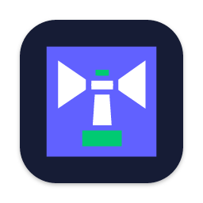
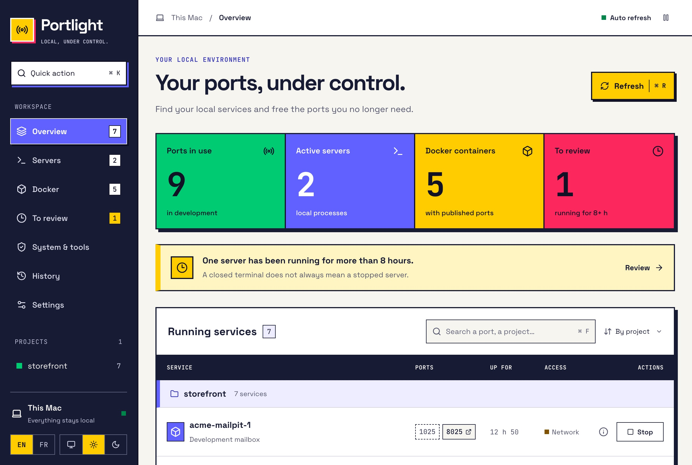

<p align="center">
  
</p>

<h1 align="center">Portlight</h1>

<p align="center">
  A local macOS app to find forgotten servers, see what holds a port, and stop the right process or container.
</p>

<p align="center">
  <a href="https://github.com/max-mxm/portlight/actions/workflows/ci.yml"></a>
  
  
  <a href="LICENSE"></a>
</p>

<p align="center">
  
  
  
  
  
  
</p>



No HTTP server in production, no account, no telemetry, no cloud. English by default, French available; light, dark or system theme.

## Features

- **Ports and servers**: every listening TCP port with its process or Docker container, grouped by git repository (worktrees included). Search by port, name, PID, command or project; fold groups or stop a whole group.
- **Safe stops**: normal stop (`SIGTERM`) first, check that ports are released, force stop only if the process resists. A launcher (`npm`, `pnpm`, `turbo`, `nodemon`…) stops with the processes it started. Containers stop with `docker stop --time 5`, alone or with their Compose project, never the Docker engine.
- **To review**: development processes running for 8 hours or more, with their recent CPU and memory.
- **Processes**: a visual `top`. Two minutes of CPU history, a heat strip per application, memory pressure, swap, temperature, fans, GPU and power of the Mac, then every process grouped by application. Quit apps like `⌘Q`, or select several items to see what they would free.
- **Programme guide or simplified view**: services drawn as blocks on a timeline up to now, with the review threshold marked; or, from Settings or the top bar, compact lists with an age meter.
- **Menu bar**: occupied development ports and a stop shortcut per service, always confirmed in the window.
- **Everyday**: open a web port, the project folder or your editor, copy the stop command, keep the last 50 actions. `⌘K` quick actions (`:3000` frees port 3000), `⌘F` search, `⌘R` refresh.

## Getting started

Requirements: **macOS 12+**, **Node.js 22+**, **stable Rust** and **Xcode Command Line Tools** (`xcode-select --install`). Docker is optional; Portlight finds the CLI of Docker Desktop, Homebrew, Colima, OrbStack and Rancher Desktop. Validated on Apple silicon.

```sh
git clone https://github.com/max-mxm/portlight.git
cd portlight
npm ci
npm run app:dev
```

`npm run dev` starts only the web interface (Vite on `127.0.0.1:1420`), which cannot inspect or stop processes.

To build the app, then get a JSON snapshot without opening the window:

```sh
npm run app:build
open src-tauri/target/release/bundle/macos/Portlight.app
src-tauri/target/release/portlight --scan-json
```

The local build is neither signed with a Developer ID nor notarized.

## How it works

1. Rust collects listening ports (`lsof`, `netstat`), the process table (one `ps`), working folders (one `lsof`) and Docker containers (`docker ps`, `docker inspect`): six system commands per scan, whatever the number of services.
2. The interface receives the inventory through typed Tauri IPC commands and groups it by project.
3. Every stop is confirmed. The backend revalidates the target itself (PID and start time, container ID, launcher, Compose members), sends the signal, then checks that the ports are released.

System commands never go through a shell. Settings and history stay on the Mac.

| Path                                                             | Role                                                       |
| ---------------------------------------------------------------- | ---------------------------------------------------------- |
| `src-tauri/src/scan.rs`, `docker.rs`, `project.rs`, `lineage.rs` | Inventory: ports, containers, projects, launcher chains    |
| `src-tauri/src/monitor.rs`, `sensors.rs`                         | Processes view: CPU, memory, SMC sensors, GPU              |
| `src-tauri/src/actions.rs`, `process.rs`                         | Revalidation, signals, Docker stops, shell-free execution  |
| `src-tauri/src/lib.rs`, `tray.rs`, `settings.rs`, `i18n.rs`      | IPC commands, menu bar, settings, backend texts            |
| `src/`                                                           | React interface, hooks, English and French texts (`i18n/`) |

## Limitations

- Only **listening TCP ports**: no UDP sockets or outgoing connections. Portlight never asks for administrator rights, so some system metadata may be missing.
- Stops are limited to development processes of the current user and Docker containers. The Processes view can quit any process of the current user. macOS services, IDEs, emulators, container engines and Portlight itself are always protected.
- Identity relies on the PID and start time from `ps` (one-second precision), checked again before each signal. This reduces the risk of PID reuse without the guarantee of a process handle; a supervisor may restart a process, and Portlight reports a port still occupied.
- Launcher groups are offered only for launchers started from a shell or reparented to launchd, never for one started by an IDE or an agent.
- In the Processes view, CPU is a share of the whole Mac (all cores = 100 %), so the lines add up to the gauge; an “unattributed” line shows what no process accounts for. Memory is the Activity Monitor footprint for your processes, resident memory (`≈`) for the others. Sensors come from undocumented SMC keys, as in Stats and macmon; a figure the Mac does not expose stays empty. No CPU or memory for containers.
- No background service: refresh every 10 s while the window is visible, every 30 s from the menu bar, Processes sampled every 2 s only while visible. Launch at login is optional.

## Checks

```sh
npm run build
npm test
npm run format:check
cargo fmt --manifest-path src-tauri/Cargo.toml -- --check
cargo test --manifest-path src-tauri/Cargo.toml
cargo clippy --manifest-path src-tauri/Cargo.toml --all-targets -- -D warnings
```

Rust integration tests start their own Node servers on ephemeral ports and never stop a pre-existing service. CI runs these checks on macOS for pushes to `main` and pull requests.

## Contributing and license

See [CONTRIBUTING.md](CONTRIBUTING.md) and [docs/design-decisions.md](docs/design-decisions.md) (in French). Code under the [MIT License](LICENSE), © 2026 Maxime MxM; bundled font licenses in [THIRD_PARTY_NOTICES.md](THIRD_PARTY_NOTICES.md). The palette is inspired by Monday; Portlight has no affiliation with Monday.
